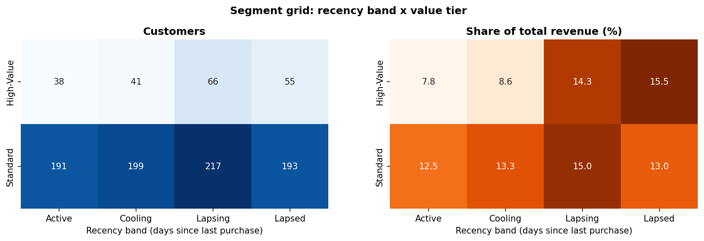
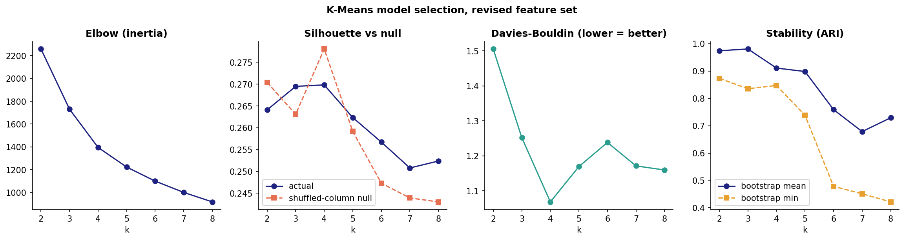

# Customer Segmentation: Transparent RFM Rules vs K-Means

> **⚠️ Synthetic data.** Every record in this repository is simulated. The dataset was generated to resemble a direct-to-consumer
> beauty and wellness CRM export (1,010 rows with deliberate duplicates, missing values and inconsistent categories). No real company,
> customer or campaign is involved, and no result here describes real business performance.

An exploratory customer segmentation of 1,000 customers that **tests whether clustering adds anything beyond simple rules**. It doesn't.
The final deliverable is therefore a deterministic, rule-based segmentation (recency band x value tier) with a documented audit trail.

This is version 2 of the project. Version 1 used K-Means plus RFM segment names that the data did not support. The audit that led to
this rebuild is summarised in [`reports/audit_log.md`](reports/audit_log.md).

---

## Key results

All figures come from `notebooks/customer_segmentation.ipynb` and are stored in [`reports/metrics.json`](reports/metrics.json).

| Metric | Value |
|---|---|
| Customers (after removing 10 exact duplicates) | 1,000 |
| Total revenue (uncapped spend) | $260,484 |
| Mean / median total spend per customer | $260.48 / $203.28 |
| Average order value: order-weighted / mean of customer AOV | $64.50 / $85.22 (957 customers with an observed order count) |
| Median days since last purchase | 202 |
| Top 20% of customers by spend: share of revenue | 46.2% |
| Supplied churn score >= 0.70 | 539 customers (53.9%), but the score is almost a function of recency (see below) |

**What the data supports**
1. **Recency and spend are the only informative axes.** Orders, email open rate, acquisition channel, preferred category, country and
   gender show no detectable relationship with spend or with segment membership (16 tests, all non-significant after Holm correction,
   all effect sizes negligible).
2. **High-value customers are drifting away.** The top 20% of customers by spend (>= $368.35) generate 46.2% of revenue,
   and 121 of those 200 customers have not purchased for more than 180 days. Those 121 account for 29.9% of all historical revenue.
3. **The supplied churn score is not independent information.** Its rank correlation with recency is 0.95, recency alone explains
   93% of its variance, and every customer inactive for more than 365 days has a score of exactly 1.00.
4. **K-Means finds no natural clusters.** On recency, orders and log spend, the silhouette (0.27 at k = 3 or 4) is no better than the same data with
   its columns shuffled independently (0.26 and 0.28). A two-level decision tree reproduces 95% of the cluster labels. The original
   model's apparent structure came from counting recency twice (recency plus the churn score).

---

## Segmentation

| Recency band | Days since last purchase |
|---|---|
| Active | 0-90 |
| Cooling | 91-180 |
| Lapsing | 181-365 |
| Lapsed | over 365 |

**Value tier:** High-Value means the top 20% of customers by total uncapped spend (>= $368.35). Everyone else is Standard.
Customers with tenure of 180 days or less are flagged as `newer_customer` (87 customers). This is an attribute, not a segment,
because nobody in the data signed up in the four months before the analysis date.

| Segment | Customers | % customers | % revenue | Median days since purchase | Median orders | Median spend | Median AOV |
|---|---|---|---|---|---|---|---|
| Active High-Value | 38 | 3.8 | 7.8 | 54 | 3 | $471.97 | $188.92 |
| Active Standard | 191 | 19.1 | 12.5 | 50 | 4 | $164.58 | $42.94 |
| Cooling High-Value | 41 | 4.1 | 8.6 | 139 | 4 | $480.89 | $110.99 |
| Cooling Standard | 199 | 19.9 | 13.3 | 128 | 4 | $160.04 | $42.72 |
| Lapsing High-Value | 66 | 6.6 | 14.3 | 255 | 4 | $466.96 | $128.27 |
| Lapsing Standard | 217 | 21.7 | 15.0 | 256 | 4 | $166.84 | $42.93 |
| Lapsed High-Value | 55 | 5.5 | 15.5 | 500 | 3 | $516.28 | $204.83 |
| Lapsed Standard | 193 | 19.3 | 13.0 | 478 | 4 | $162.88 | $40.24 |

The segments are deterministic: shuffling the input rows changes no assignment. In the original version, row order alone moved 60 to 74 customers between segments.



### Suggested actions (hypotheses to test, not predicted results)

The data has no campaign, cost or response history, so no ROI or uplift can be estimated. Each action should be run with a holdout group.

| Segment group | Suggested test | Why this segment |
|---|---|---|
| Lapsing and Lapsed High-Value (121) | Personal or high-touch win-back. Compare reactivation against a holdout. | 29.9% of historical revenue; no purchase for 181+ days |
| Active and Cooling High-Value (79) | Retention and recognition (early access, service). Avoid discount-led offers. | High spend, recently active |
| Cooling Standard (199) | Timed reminder or replenishment message around 90-180 days | Activity is fading but still recent |
| Lapsed Standard (193) | Low-cost reactivation, then a sunset or suppression rule | Low value, inactive for over a year |
| Active Standard (191) | Normal programme. Test basket-building offers (median AOV is $43 vs $189 in Active High-Value). | Recent but low spend per order |

**Compliance flag.** 75 customers are recorded as under 18 (19 of them High-Value, including the single highest spender).
Check consent rules before including them in any campaign.

---

## Methodology summary

Full detail: [`reports/methodology.md`](reports/methodology.md).

1. **Cleaning.**
   - Dropped 10 exact duplicates.
   - Standardised gender and category labels (missing gender is kept as "Unknown").
   - Set 17 impossible "0 orders with spend" values to 1 and imputed 26 missing order counts with the median (all flagged).
   - Imputed 48 missing ages with the median (flagged; age is not used for segmentation).
   - Flagged the 75 under-18s.
2. **No spend cap.** Revenue always uses uncapped spend. Clustering uses `log1p(spend)`.
3. **Deterministic RFM scores** (exported for reference):
   - R and M are quintiles computed on the values themselves.
   - F uses fixed bins: 1 | 2 | 3-4 | 5-6 | 7+ orders.
4. **Primary segmentation:** recency band x value tier, with fixed thresholds.
5. **Clustering, exploratory only.** K-Means with k = 2 to 8 on three feature sets (original, original without churn, revised). Each was evaluated with:
   - inertia, silhouette, a shuffled-column null silhouette, Davies-Bouldin, Calinski-Harabasz and Gaussian-mixture BIC;
   - bootstrap ARI, row-shuffle ARI, agreement with Ward clustering, and how much of each solution a depth-2 decision tree reproduces.
6. **Insight tests.** Kruskal-Wallis and chi-square tests with epsilon-squared or Cramér's V effect sizes, Holm-corrected as one family.



---

## Limitations

- **Synthetic data.** Channels, categories and the churn score appear to have been generated independently of purchasing behaviour.
- **No transaction-level data.** There is no basket, timing, return or margin information, so cross-sell, journey or CLV modelling is not possible.
- **No costs or campaign outcomes.** No financial impact can be calculated.
- **A single snapshot.** Movement between segments over time cannot be measured.
- **Thresholds are conventional choices.** The 90, 180 and 365-day bands and the top-20% value cut-off can change segment sizes.
- **Frequency corrections and imputations** affect a small number of customers, all of them flagged in the data.

---

## Repository structure

```
ecommerce-customer-segmentation/
├── README.md
├── requirements.txt                 pinned versions used to run the notebook
├── notebooks/
│   └── customer_segmentation.ipynb  canonical analysis (runs top to bottom)
├── src/                             cleaning, segmentation, clustering and stats functions used by the notebook
├── data/
│   ├── raw/customer_segmentation_dataset.csv        synthetic source (1,010 rows)
│   ├── cleaned/customer_segmentation_cleaned.csv    cleaned, with data-quality flags
│   └── processed/                                   dashboard-ready exports
│       ├── customer_segments.csv                    one row per customer with scores, segment, flags
│       ├── segment_profiles.csv
│       └── exploratory_cluster_profiles.csv
├── reports/
│   ├── executive_summary.md
│   ├── methodology.md
│   ├── audit_log.md                 what was wrong in v1 and what changed
│   ├── metrics.json                 every headline figure, written by the notebook
│   └── tables/                      model selection, insight tests, reconciliation, cleaning log
├── sql/
│   ├── schema.sql, analysis_queries.sql
│   └── test_queries.py              runs the SQL on SQLite and checks it against metrics.json
├── visuals/charts/                  9 charts, one file per chart
├── dashboards/README.md             how to build a dashboard from the exports
└── archive/original_project/        v1 notebooks, charts, SQL and reports, kept unchanged for reference
```

## How to run

```bash
pip install -r requirements.txt
cd notebooks
jupyter nbconvert --to notebook --execute --inplace customer_segmentation.ipynb   # or open it in Jupyter and Run All
cd ..
python sql/test_queries.py
```

The notebook can also be run from the repository root. It needs `archive/original_project/customer_segmentation_output.csv`
to reproduce and compare against the original results.

---

**Patience Anono** · [padataanalytics.com](https://padataanalytics.com)
